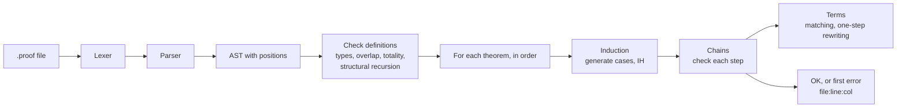

# induction-proof-checker

A small Scala 3 command-line tool that checks proofs by structural induction (including ordinary induction on the natural numbers) written in a simple text format.

[](https://github.com/adam-sadik/induction-proof-checker/actions/workflows/ci.yml)

```
$ sbt "run examples/add_comm.proof"
OK
```

## Why induction works

### Induction on the natural numbers

Let $\mathbb{N} = \{0, 1, 2, \dots\}$. We use the **well-ordering principle**: every non-empty subset of $\mathbb{N}$ has a least element.

**Theorem (induction).** Let $P$ be a property of natural numbers. If

1. $P(0)$ holds, and
2. for every $n \in \mathbb{N}$, $P(n)$ implies $P(n+1)$,

then $P(n)$ holds for every $n \in \mathbb{N}$.

*Proof (least counterexample).* Suppose the conclusion is false. Then

$$S = \{\, n \in \mathbb{N} \mid \neg P(n) \,\}$$

is non-empty, so by well-ordering it has a least element $m$. By (1), $m \neq 0$, so $m = k + 1$ for some $k \in \mathbb{N}$. Since $k < m$ and $m$ is the least element of $S$, we have $k \notin S$, that is, $P(k)$ holds. By (2), $P(k+1)$ holds, that is, $P(m)$ holds. This contradicts $m \in S$. Hence $S = \emptyset$. $\blacksquare$

### Structural induction on inductive data types

An inductive data type such as

```
data List = Nil | Cons(Nat, List)
```

consists of all **finite** trees built by applying constructors. Every value $v$ has a finite *height*:

$$h(C(a_1, \dots, a_k)) = \begin{cases} 0 & \text{if no } a_i \text{ has type } T \\ 1 + \max\{\, h(a_i) \mid a_i \text{ has type } T \,\} & \text{otherwise.} \end{cases}$$

Each argument $a_i$ of the same type $T$ is a *strict subterm* of $C(a_1,\dots,a_k)$, and its height is strictly smaller.

**Theorem (structural induction).** Let $T$ be an inductive type with constructors $C_1, \dots, C_r$ and let $P$ be a property of values of $T$. Suppose that for every constructor $C = C_j$ with arguments $a_1, \dots, a_k$:

> if $P(a_i)$ holds for every argument $a_i$ of type $T$, then $P(C(a_1,\dots,a_k))$ holds.

Then $P(v)$ holds for every $v \in T$.

*Proof.* Suppose some value is a counterexample. The set of heights of counterexamples is a non-empty subset of $\mathbb{N}$, so it has a least element; pick a counterexample $v = C(a_1,\dots,a_k)$ of that least height. Every argument $a_i$ of type $T$ has smaller height, so it is not a counterexample: $P(a_i)$ holds. By the hypothesis for $C$, $P(v)$ holds, a contradiction. $\blacksquare$

For constructors with no argument of type $T$ (like `Nil` or `Zero`) the hypothesis is vacuous, so the statement requires $P(C(\dots))$ outright. This is the base case. For $T = \mathsf{Nat}$ with constructors `Zero` and `Succ`, the height of $\mathsf{Succ}^n(\mathsf{Zero})$ is $n$ and the theorem is exactly the ordinary induction principle above.

### What the checker relies on

The checker relies on exactly this principle: **structural induction over the declared `data` types, whose values are finite constructor trees, i.e. the strict subterm order is well-founded.** For a theorem proven by induction on a variable $x : T$ it checks the hypothesis of the theorem above for *every* constructor of $T$, with the induction hypothesis stated for *every* argument of type $T$. It also relies on ordinary equational reasoning (reflexivity, symmetry, transitivity, congruence, instantiation of universally quantified equations), where each use of a definition or lemma is a rewrite step.

## What the tool does and does not do

**Does**

- Parse a proof file and check every definition and every proof in it.
- Print `OK`, or the **first** error with file, line and column and an explanation. The exit code is non-zero on error.

**Does not**

- Search for proofs, suggest steps or automate anything. Every step must be written out and justified.
- Have a GUI, a standard library, polymorphism or arithmetic. Everything is defined in the file.

## The proof format

A file contains `data` declarations, function definitions and theorems. Comments start with `--`.

```
data Nat = Zero | Succ(Nat)

def add : (Nat, Nat) -> Nat
def add(Zero, m)    = m
def add(Succ(n), m) = Succ(add(n, m))

theorem add_zero_right: forall n: Nat. add(n, Zero) = n
proof by induction on n:
  case Zero:
    add(Zero, Zero)
    = Zero                    by def add
  case Succ(k) [IH: add(k, Zero) = k]:
    add(Succ(k), Zero)
    = Succ(add(k, Zero))      by def add
    = Succ(k)                 by IH
qed
```

- `data T = C1(T1, ..., Tn) | C2 | ...` declares a type and its constructors. A constructor name used without arguments is a constant.
- `def f : (T1, ..., Tn) -> R` is followed by one equation `def f(pattern, ...) = term` per case. Patterns are variables or constructors applied to patterns.
- `theorem name: forall x: T, y: U. lhs = rhs` is followed by `proof by induction on x:` and one `case` per constructor of the type of `x`, then `qed`.
- A case is `case C(a1, ..., an) [IH: ...]:` followed by a chain. The names `a1 ... an` are fresh constants standing for the constructor's arguments. The `[IH: ...]` annotation lists the induction hypotheses, one for each argument of the induction type. It is written out for readability, and the checker verifies that it is the right one.
- A chain is a term followed by steps `= term by justification`. It must start at the left-hand side of the goal for that case and end at its right-hand side.

| Justification | Meaning |
|---|---|
| `by def f` | rewrite once with an equation of `f`, left to right |
| `by IH` | rewrite once with an induction hypothesis of this case |
| `by lemma name` | rewrite once with a theorem proven **earlier** in the file |
| `by <- ...` | the same, but right to left |

A step `t1 = t2 by J` is valid exactly when `t2` is obtained from `t1` by applying the rule `J` **once**, at one subterm.

## Quick start

Requirements: JDK 17 or newer and [sbt](https://www.scala-sbt.org/). Dependencies (Scala 3, munit) are downloaded by sbt.

```
sbt compile                                # build
sbt "run examples/add_zero_right.proof"    # check a proof
sbt test                                   # run the tests
```

The exit code is `0` for a valid proof, `1` for a syntax or proof error and `2` for a usage error or an unreadable file.

## How it works



Pipeline: **parse → check definitions → check proofs**. Only `core/` is trusted, and it depends on nothing but the AST.

Key ideas:

- **Matching.** A rule such as `add(Succ(n), m) = Succ(add(n, m))` has universally quantified variables `n` and `m`. One-way matching finds the substitution that makes the left-hand side equal to a subterm of the current term.
- **One-step rewriting.** `rewriteOnce(rule, t)` returns all terms obtained by applying the rule at exactly one position. A step is valid if the claimed term is among them. When it is not, the error shows what the rule *would* have produced.
- **Case generation.** The checker builds the cases itself from the `data` declaration: one per constructor, none missing, none duplicated. For `Cons(h, t)` the goal is the theorem with `xs := Cons(h, t)`, and the induction hypothesis is the theorem with `xs := t`.
- **IH as constants.** In a case, `k`, `h`, `t` and the other theorem variables are *fixed constants*, not pattern variables. Only definitions and lemmas have quantified variables. So `add(k, Zero) = k` can be used on `add(k, Zero)` but not on `add(j, Zero)` or `add(Succ(k), Zero)`. This reflects the fact that the induction hypothesis is a statement about one specific `k`.

## Soundness

A definition is used as a rewrite rule, so it must be a true statement about the intended meaning of the function. The checker enforces this:

| Check | Why it matters |
|---|---|
| **Non-overlapping equations** | If two equations match the same arguments they can disagree. With `def f(Zero) = Zero` and `def f(n) = Succ(Zero)`, one gets `Zero = f(Zero) = Succ(Zero)`. |
| **Structural recursion** | Recursive calls must be on a strict subterm of a pattern argument, always at the same argument position. Otherwise `def f(n) = Succ(f(n))` would give `f(Zero) = Succ(f(Zero))`, which is false for any natural number. Allowing a different position per equation is unsound too: arguments can swap forever. |
| **Totality** | Every function has a value on every input, so a theorem about `f` says what it appears to say (the intended model is total functions on finite constructor trees). |
| **Types** | Terms are well-typed, so rules are only applied to values of the right type. |
| **Lemmas only after their proof** | A theorem is added to the lemma environment after its own proof has been checked, which rules out circular reasoning. |
| **IH as constants** | Treating IH variables as pattern variables would let the induction hypothesis be applied to *any* term, which proves the theorem without induction. |

With these checks every definition has a unique solution on finite constructor trees, and each step of a proof is an instance of equational reasoning from true equations.

## Examples

Valid proofs are in [`examples/`](examples): `add_zero_right`, `add_succ_right`, `add_comm`, `add_assoc`, `append_nil`, `append_assoc`, `rev_append`, `rev_rev`.

Wrong proofs are in [`examples/invalid/`](examples/invalid), each with the expected message in a `.expected` file. For instance, `wrong_step.proof` justifies `add(Succ(k), Zero) = Succ(k)` by `def add`:

```
examples/invalid/wrong_step.proof:15:5: cannot justify step 'add(Succ(k), Zero) = Succ(k)' by def add: rule gives 'Succ(add(k, Zero))', expected 'Succ(k)'
```

Other cases: a missing induction case, a wrong induction hypothesis, a circular lemma, a chain that stops early, a non-total, non-structural or overlapping definition, and a syntax error.

## Limitations and possible future work

- The induction hypothesis is for the same values of the other variables; it cannot be generalized over them. Theorems that need a generalized hypothesis (for example with an accumulator) cannot be proven directly.
- Induction on one variable per theorem, with no nested induction and no case analysis without induction.
- Recursion is checked with a single decreasing argument. Mutual recursion, lexicographic orders and well-founded recursion are rejected.
- No polymorphic types, conditional equations, or built-in numbers.
- Only the first error is reported.
- Possible future work: lexicographic termination, generalizing variables in the hypothesis, nested induction, polymorphic types, several errors per run.

## Acknowledgements

Inspired by concepts from the CS214 Software Construction course at EPFL (algebraic data types, pattern matching, interpreters) and by the author's interest in mathematics and logical reasoning.

License: [MIT](LICENSE).
